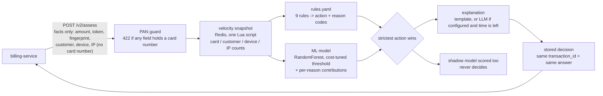
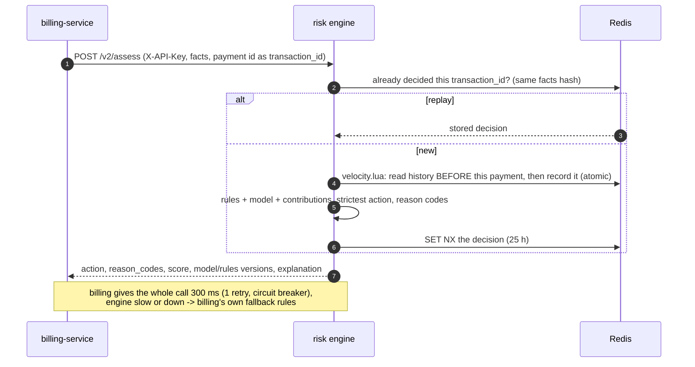

<div align="center">

# Payment Risk Engine

**A real-time card-payment risk check: velocity features in Redis, explainable rules with reason codes, a
cost-tuned ML model, a 300 ms budget, and a feedback loop that learns from chargebacks.**

[](https://github.com/amitsaini1912/payment-risk-engine/actions/workflows/ci.yml)


</div>

It decides, before a card is charged, whether a payment should go through (`allow`), wait for a human
(`hold_for_review`) or stop (`block`), and says why in reason codes a reviewer can act on. Its caller is the
billing service of [patient-management-microservices](https://github.com/amitsaini1912/patient-management-microservices),
which never charges a card the engine (or its own fallback rules) didn't allow.

It started at the Razorpay AI Buildathon (AI Risk Manager track) as a scorer + LLM agent + dashboard (`/assess`,
still here) and grew into the `/v2/assess` service below.

## The problem

A card-not-present payment is approved in milliseconds, but the cardholder can dispute it for weeks. A chargeback
pulls the money back, adds a dispute fee, and costs operations time; card networks penalise merchants whose
chargeback rate stays high. A risk check has to:

- decide **before** the network is asked, inside the caller's time budget (here 300 ms), every time;
- see what a single payment can't: **velocity** (how many payments on this card / by this customer in the last
  hour), new devices, a card shared across devices;
- be **explainable**: a held payment needs a reason a reviewer understands, not just a score;
- never be the reason payments stop: when it is slow or down, the caller must have a safe default;
- **learn**: chargebacks arriving weeks later must become training labels.

## How a decision is made





The feedback loop: billing publishes `chargeback.created` and `payment.outcome` (captured, review approved / rejected)
to Kafka through its outbox. The engine's consumer stores them next to the decision, so precision and recall are
measured on real outcomes (`GET /feedback/performance`), and `scripts/retrain.py` (default `--population captured`)
retrains on payments that were really captured, with their real labels.

## What it guarantees — and the evidence

| Guarantee | How | Evidence |
|---|---|---|
| Same question, same answer | decisions stored by `transaction_id` + request hash (different facts = 409) | ADR 0003, replay tests |
| Velocity counts are exact under concurrency | one Redis Lua script reads and records atomically | hypothesis model test (`test_properties.py`) |
| Explainable | 12 reason codes from rules and from the model's per-feature contributions | ADR 0002 |
| Within budget | deadline per request; optional work (LLM wording, shadow) skipped when time runs out | ADR 0003 |
| No card numbers in, none logged | Luhn-based PAN guard on every field (422, value never echoed); log + audit masking | ADR 0004, ADR 0010 (3 false-positive / masking bugs found under load and fixed) |
| Safe model changes | versioned models, shadow model on live traffic, PSI drift per feature | `GET /governance/shadow`, `/governance/drift` (ADR 0004) |
| Learns from outcomes | Kafka consumer (own DLT), labels by `transaction_id` | ADR 0005, 0006 |

Load (k6, same laptop as billing's tests): one worker answered every check up to **30 payments/s** after a profiling
fix cut CPU per decision from ~45 ms to ~23 ms (forest inference without scikit-learn's per-tree overhead, features
computed once); see ADR 0010 and billing's `docs/PERFORMANCE.md`.

## Run it

```bash
python3.12 -m venv venv && venv/bin/pip install -r requirements.txt
venv/bin/python data/generate_data.py --rows 15000 --seed 42 --out data/transactions.csv
venv/bin/python model/train.py                 # model.pkl + shadow.pkl + metrics.json

docker run -d -p 6379:6379 redis:7.4-alpine
RISK_API_KEYS=billing:dev-key-0123456789 venv/bin/uvicorn api.main:app --port 8000

curl -s localhost:8000/v2/assess -H 'X-API-Key: dev-key-0123456789' -H 'Content-Type: application/json' -d '{
  "transaction_id":"pay-1","amount_minor":150000,"currency":"INR","card_token":"tok_abcdefgh23",
  "card_fingerprint":"fp0123456789abcdef","last4":"4242","customer_id":"cust-1","merchant_id":"M1001",
  "ip":"203.0.113.7","device_id":"dev-1","timestamp":"'"$(date -Iseconds)"'"}'
# -> "action":"allow", "reason_codes":["R04_NEW_ACCOUNT","R03_NEW_DEVICE"], "model_score":0.0965, "decided_in_ms":23.7 ...
```

As a container: `docker build -t payment-risk-engine .` (trains the model during the build). With the whole payments
system: billing's `docker-compose.yml` builds this repo from `../payment-risk-engine`.

| Endpoint | |
|---|---|
| `POST /v2/assess` | the decision (API key) |
| `GET /health`, `GET /ready` | liveness; readiness (keys, rules, model and Redis usable) |
| `GET /metrics/prometheus` | latency histogram, decisions, 503s, budget overruns, drift |
| `GET /governance/shadow`, `GET /governance/drift` | champion vs shadow agreement; PSI per feature |
| `GET /feedback/performance`, `GET /feedback/{id}` | precision / recall on real outcomes; one decision's outcome |
| `POST /assess`, `GET /audit`, `GET /audit/{id}` | v1 (buildathon): score + LLM agent + rule fallback, audit trail |

Configuration: `RISK_API_KEYS` (`caller:key,...`, required), `REDIS_URL`, `RISK_BUDGET_MS` (300),
`KAFKA_ENABLED` / `KAFKA_BOOTSTRAP_SERVERS` (feedback consumer), `GEMINI_API_KEY` (optional LLM wording),
`OTEL_EXPORTER_OTLP_ENDPOINT` (tracing), `LOG_FORMAT=json`, `MODEL_FAST_FOREST` (default true).

## Tests

```bash
venv/bin/python -m pytest -q        # 253 tests (Testcontainers: Redis, Kafka), ~70 s
venv/bin/ruff check .
venv/bin/python -m pytest -q --cov=agent --cov=api --cov=risk_v2 --cov=model   # 92% of lines
```

CI (GitHub Actions) lints, generates the data, trains the model (so the model tests really run), and runs the tests
with coverage on every push.

## Data

### Why synthetic

- **Control of signal.** The generator plants known fraud patterns, so we can
  verify the model learns real structure rather than an artefact.
- **No licensing / PII risk** from real payment data.
- **Tunable imbalance.** We target a realistic 2–8% chargeback rate (~6% here).

The label is never a coin flip. For each transaction the generator builds a
"true" chargeback probability = small base rate × pattern multipliers, with some
patterns imposing a probability floor, then draws the label from it. Run
`python data/generate_data.py` to print each pattern's prevalence and its
observed chargeback lift.

### Hand-crafted fraud patterns

| ID | Pattern | Intuition | Observed lift |
|----|---------|-----------|---------------|
| P1 | New account (≤30d) + high amount (≥₹15k) + odd hour | Stolen card, cash out fast | ~8× |
| P2 | Customer has prior chargebacks | Recidivism / compromised account | ~4× |
| P3 | ≥6 tiny transactions in the last hour | Card-number testing | ~5× |
| P4 | IP country ≠ billing country, or new device on a high-value buy | Account takeover | ~4× |
| P5 | Prepaid or international card + high amount | Anonymous / hard-to-recover instrument | ~8× |
| P6 | Amount ≫ customer's average order value | Spend spike after takeover | ~5× |
| P7 | Disposable email domain | Throwaway identity | ~2× |

### Regenerate

```bash
python data/generate_data.py --rows 15000 --seed 42 --out data/transactions.csv
```

Deterministic given `--seed`. Debug columns (`_true_prob`, `_patterns_fired`)
are dropped from the CSV by default so they cannot leak the label; pass
`--keep-debug-cols` to inspect them.

### Data dictionary (`data/transactions.csv`)

| Column | Type | Description |
|--------|------|-------------|
| `transaction_id` | str | Unique transaction identifier |
| `merchant_id` | str | Merchant identifier (~100 merchants) |
| `merchant_category` | str | electronics, fashion, travel, gaming, grocery, digital_goods, jewellery, food_delivery |
| `customer_id` | str | Customer identifier (~3.7k, attributes stable across their transactions) |
| `amount` | float | Transaction amount in INR |
| `payment_method` | str | card, upi, netbanking, wallet, emi |
| `card_type` | str | credit, debit, prepaid, or `na` for non-card methods |
| `is_international_card` | int | 1 if the card was issued outside India |
| `timestamp` | str | ISO 8601 transaction time (120-day window from 2025-05-01) |
| `hour` | int | Hour of day 0–23 (derived from timestamp) |
| `is_new_device` | int | 1 if this device has not been seen for this customer |
| `ip_address` | str | Transaction IP |
| `ip_country` | str | Country the IP geolocates to |
| `billing_country` | str | Customer's billing country |
| `ip_billing_country_mismatch` | int | 1 if `ip_country` ≠ `billing_country` |
| `account_age_days` | int | Age of the customer account at transaction time |
| `past_chargebacks` | int | Count of prior chargebacks by this customer |
| `past_orders` | int | Count of prior completed orders by this customer |
| `avg_order_value` | float | Customer's historical average order value (INR) |
| `txn_count_1h` | int | Transactions by this customer in the preceding 1 hour |
| `txn_count_24h` | int | Transactions by this customer in the preceding 24 hours |
| `email_is_disposable` | int | 1 if the signup email domain is a known throwaway provider |
| `is_chargeback` | int | **Label.** 1 if the transaction was later charged back |

## Model

Three class-balanced candidates (logistic regression, random forest, histogram gradient boosting) are trained on a
60/20/20 split. **Selection = the lowest expected rupee cost on the validation set at its own tuned threshold**;
the test set is only used for the numbers below. Feature engineering (`model/features.py`) is shared by training
and serving, so the two can't drift apart.

### Cost-based threshold

| Mistake | Cost |
|---------|------|
| Missed chargeback (FN) | transaction amount + ₹1,500 dispute fee + ₹500 ops |
| False alarm (FP) | ₹400 manual review |

The threshold minimises that cost on the validation set, subject to a **precision floor of 0.30**: review capacity
is finite, and below ~30% reviewers mostly look at good payments.

### Shipped model (seed 42, `model/metrics.json`)

| | |
|---|---|
| Selected | random forest (300 trees), version `rf-b677801468`; shadow: logistic regression |
| Threshold | 0.404 (unconstrained cost minimum 0.345 had validation precision 0.29) |
| Test set (n = 3,000, 166 chargebacks) | recall **0.81**, precision 0.29, PR-AUC 0.41, ROC-AUC 0.91 |
| Confusion | TP 135 · FP 324 · FN 31 · TN 2,510 |
| Expected cost | **₹102 / payment** vs ₹713 approving everything (−86%) and ₹378 reviewing everything |

A tree model partly because a flag must be explainable: the per-reason contributions (score minus the score with
that reason's inputs made normal) become the model's reason codes.

## v1: the buildathon agent

`POST /assess` scores a transaction, lets an LLM reasoning agent (Gemini) choose the action and write a
justification, and falls back to deterministic rules whenever the LLM fails or times out (`agent/`, `dashboard/`).
Every v1 decision is written to an audit trail. The dashboard: `venv/bin/streamlit run dashboard/app.py`.

## Decisions

`docs/adr/` — 10 records: the v2 contract (0001), rules and reason codes (0002), production behaviour
(idempotency, budget, auth, readiness: 0003), PCI and model governance (0004), the feedback loop (0005, 0006),
tracing + the first PAN false positive (0007, amended by 0010), JSON logs (0008), property-based tests (0009), load-test findings (0010).
`docs/contracts/` — JSON schemas of the Kafka events billing sends.

## Known limitations

- One uvicorn worker per container: scale with replicas. More processes per container need Prometheus multiprocess
  mode and a real database for the feedback store (SQLite today).
- Synthetic training data (patterns are planted, so the model's numbers say it learns them, not that it would catch
  real fraud). The feedback loop is the path to real labels.
- Model artefacts are pickles trained at build time; no model registry.
- Accepted PAN-guard blind spot: a card number hidden inside an exactly-64-hex-character token.
